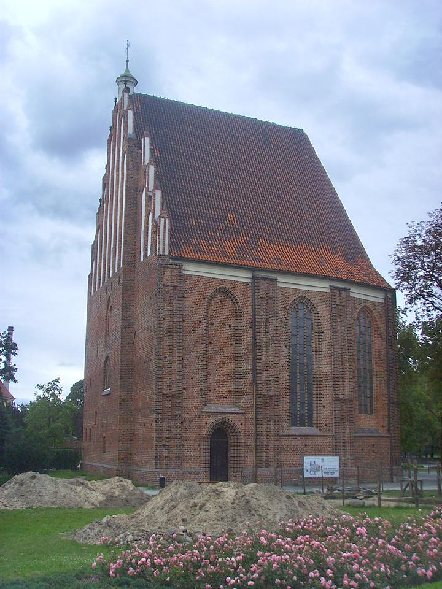
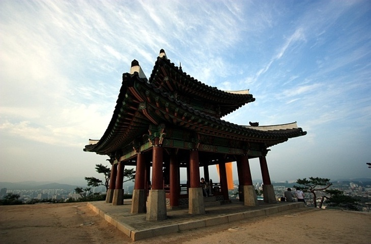
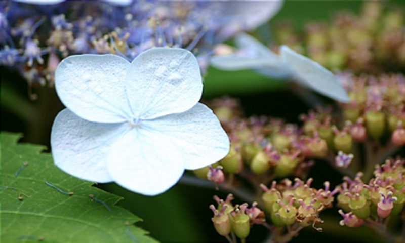
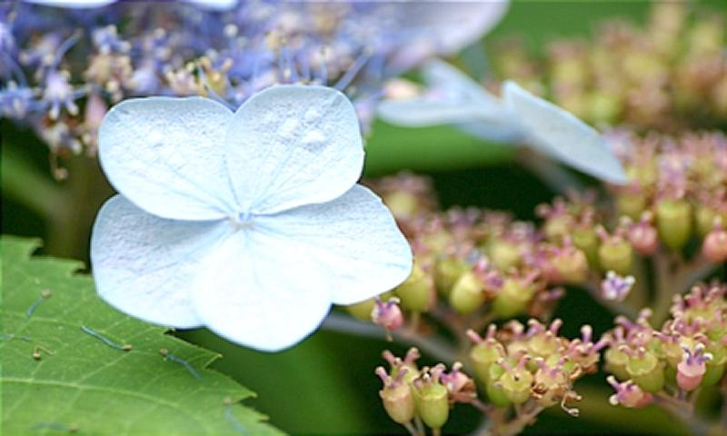

# Image-Contrast-Enhancement
Python implementations of "[A New Image Contrast Enhancement Algorithm Using Exposure Fusion Framework](https://baidut.github.io/OpenCE/caip2017.html)"

### Already Implemented
- Histogram Equalization (`he.py`)
- Dynamic Histogram Equalization (`dhe.py`)
- Exposure Fusion Framework — Ying et al., CAIP 2017 (`ying.py`)

### Requirements
- Python >= 3.9
- `numpy>=1.26.0,<3.0.0`
- `scipy>=1.13.0,<2.0.0`
- `opencv-python>=4.10.0,<5.0.0`
- `scikit-image>=0.24.0,<1.0.0`
- `matplotlib>=3.9.0,<4.0.0`
- `imageio>=2.34.0,<3.0.0`
- `pillow>=10.4.0,<13.0.0`

### Environment Setup

#### Option 1: One-command setup script (Recommended)
```bash
./setup_env.sh
source .venv/bin/activate
```

Useful flags:
- `./setup_env.sh --python /path/to/python3.11` — specify a Python interpreter
- `./setup_env.sh --recreate` — delete and rebuild `.venv` from scratch

The script automatically uses `uv` if installed, otherwise falls back to Python's built-in `venv` + `pip`, and verifies all package imports and versions.

#### Option 2: Manual setup
```bash
python3 -m venv .venv
source .venv/bin/activate
pip install --upgrade pip
pip install -r requirements.txt
```

### Usage

Display enhanced image in a window:
```bash
# Exposure Fusion Framework (Ying et al., CAIP 2017)
python ying.py testdata/01.jpg

# Dynamic Histogram Equalization (DHE)
python dhe.py testdata/01.jpg

# Histogram Equalization (HE)
python he.py testdata/01.jpg
```

Save output directly to a file (optional `--no-show` for headless/batch runs):
```bash
python ying.py testdata/01.jpg -o output/01_ying.jpg --no-show
python dhe.py testdata/01.jpg -o output/01_dhe.jpg --no-show
python he.py testdata/01.jpg -o output/01_he.jpg --no-show
```

### Modernization & API Migration Notes
The codebase has been updated from its original 2020 dependencies (`scipy==1.2.2`, `numpy==1.18.2`, `imageio==2.8.0`, etc.) to modern Python & library versions:

- **`scipy.misc.imresize` (removed in SciPy 1.3+)** → Replaced in `ying.py` with `imresize_bicubic()` using Pillow's `Image.fromarray(..., float32)` + `Image.Resampling.BICUBIC`, matching the original `mode='F', interp='bicubic'` behavior.
- **Explicit SciPy submodule imports (SciPy 1.12+)** → Replaced implicit `scipy.sparse` / `scipy.optimize` access and removed deprecated `scipy.misc` imports with explicit imports (`from scipy import optimize, signal, sparse`, `from scipy.sparse.linalg import spsolve`). Converted sparse system matrix `A` to CSC format (`.tocsc()`) to eliminate `SparseEfficiencyWarning`.
- **`imageio.imread` (deprecated in ImageIO v2/v3)** → Migrated to `imageio.v3` (`iio.imread` / `iio.imwrite`) across `he.py`, `dhe.py`, and `ying.py`.
- **NumPy 2.x / Matplotlib 3.9+ / Pillow 11+ compatibility** → Fixed float kernel size (`int(sigma)` in `np.ones`), explicit `float64` conversion before `matplotlib.colors.rgb_to_hsv` (fixes NumPy 2.0 `copy=False` `ValueError` on `uint8` images in `dhe.py`), writable array copy from Pillow (`np.array` instead of read-only `np.asarray` view in `ying.py`), explicit scalar indexing (`Hist_I[n + 1, 0]`, `s_r[n + 1, 0]`), and silenced expected zero-variance divide warnings in `np.corrcoef` (`dhe.py`).

### Results
<p align='center'>
  
  
  
  
</p>

<p align='center'>
  
  
</p>

<p align='center'>
  
  
</p>
