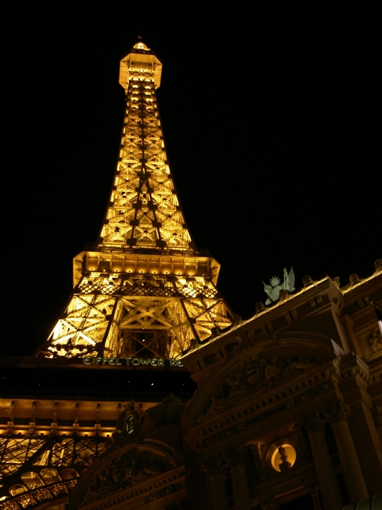
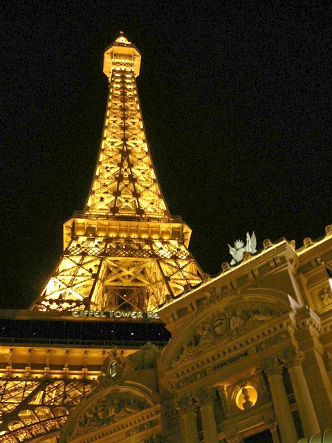
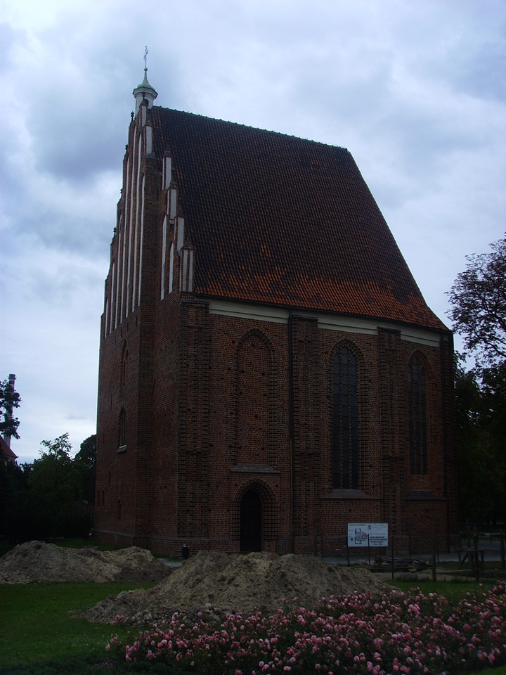
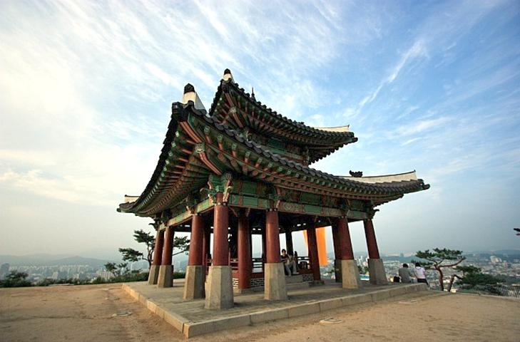

# Image-Contrast-Enhancement
[](https://github.com/AndyHuang1995/Image-Contrast-Enhancement/actions/workflows/ci.yml)

Python implementations of "[A New Image Contrast Enhancement Algorithm Using Exposure Fusion Framework](https://baidut.github.io/OpenCE/caip2017.html)"

### Already Implemented
- Histogram Equalization (`he.py`)
- Dynamic Histogram Equalization (`dhe.py`)
- Exposure Fusion Framework — Ying et al., CAIP 2017 (`ying.py`)

### Requirements
- Python >= 3.9
- `numpy>=1.26.0,<3.0.0`
- `scipy>=1.13.0,<2.0.0`
- `opencv-python>=4.10.0,<5.0.0`
- `matplotlib>=3.9.0,<4.0.0`
- `imageio>=2.34.0,<3.0.0`

### Environment Setup

#### Option 1: One-command setup script (Recommended)
```bash
./setup_env.sh
source .venv/bin/activate
```

Useful flags:
- `./setup_env.sh --python /path/to/python3.11` — specify a Python interpreter
- `./setup_env.sh --recreate` — delete and rebuild `.venv` from scratch

The script automatically uses `uv` if installed, otherwise falls back to Python's built-in `venv` + `pip`, and verifies all package imports and versions.

#### Option 2: Manual setup
```bash
python3 -m venv .venv
source .venv/bin/activate
pip install --upgrade pip
pip install -r requirements.txt
```

### Usage

Display enhanced image in a window:
```bash
# Exposure Fusion Framework (Ying et al., CAIP 2017)
python ying.py testdata/01.jpg

# Dynamic Histogram Equalization (DHE)
python dhe.py testdata/01.jpg

# Histogram Equalization (HE)
python he.py testdata/01.jpg
```

Save output directly to a file (with `--no-show` for headless/batch runs) and algorithm options:
```bash
# Ying (2017): matrix-free PCG + Neumann boundary by default
# Optional: --solver direct, --boundary periodic, --max-smooth-size 480 (0=uncapped), --lamda, --sigma, --k-max
python ying.py testdata/01.jpg --mu 0.5 --solver pcg --boundary neumann -o output/01_ying.jpg --no-show

# DHE: adjust saturation/intensity weighting with --alpha
python dhe.py testdata/01.jpg --alpha 0.5 -o output/01_dhe.jpg --no-show

# HE: per-channel RGB (default) or luminance-only YCrCb to preserve color
python he.py testdata/01.jpg --mode ycrcb -o output/01_he.jpg --no-show
```

### Testing
Install test dependencies and run `pytest`:
```bash
pip install -e ".[dev]"
pytest -v
```
Tests under `tests/` cover reference regression (`testdata/` vs `result/`), numerical equivalence of vectorized helpers and solvers, Neumann border-halo prevention, edge cases (grayscale, RGBA alpha preservation, flat/tiny images), and CLI execution.

### Algorithm Optimizations
Measured on Apple Silicon (`testdata/01.jpg` `640×480` and `testdata/03.jpg` `960×720`):

| Algorithm | Key Optimization | `01.jpg` | `03.jpg` | Speedup |
|---|---|---|---|---|
| `he.py` | `np.bincount` CDF lookup table + optional `--mode ycrcb` | `18 ms` → **`3.3 ms`** | `57 ms` → **`6.5 ms`** | **~6–9×** |
| `dhe.py` | Vectorized exact `int64` 5×5 box-sum correlation, Sobel slicing, `np.bincount` histograms, 256-entry LUT, single OpenCV HSV pass | `4836 ms` → **`20.4 ms`** | `~10+ s` → **`45.1 ms`** | **~230×** |
| `ying.py` | Matrix-free `float32` Jacobi-PCG + Neumann boundary, 256-entry `uint8` LUT for `applyK`, adaptive smoothing grid cap (`1080p`: `17.0 s` → **`113 ms`**), cumsum 1D texture weights, `np.bincount` entropy | `825 ms` → **`42.7 ms`** | `3056 ms` → **`80.8 ms`** | **~19–150×** |

All three scripts also support grayscale and RGBA (preserving the alpha channel), handle flat/degenerate images safely, and lazy-import `matplotlib.pyplot` only when displaying a window.

### Modernization & API Migration Notes
The codebase has been updated from its original 2020 dependencies (`scipy==1.2.2`, `numpy==1.18.2`, `imageio==2.8.0`, etc.) to modern Python & library versions:

- **`scipy.misc.imresize` (removed in SciPy 1.3+)** → Replaced in `ying.py` with `imresize_bicubic()` using `cv2.resize(..., interpolation=cv2.INTER_CUBIC)`, removing direct Pillow and scikit-image dependencies.
- **Explicit SciPy submodule imports (SciPy 1.12+)** → Replaced implicit `scipy.sparse` / `scipy.optimize` access and removed deprecated `scipy.misc` imports; direct solver converts `A` to CSC format (`.tocsc()`) to eliminate `SparseEfficiencyWarning`.
- **`imageio.imread` (deprecated in ImageIO v2/v3)** → Migrated to `imageio.v3` (`iio.imread` / `iio.imwrite`) across `he.py`, `dhe.py`, and `ying.py`.
- **NumPy 2.x compatibility** → Fixed float kernel sizes (`int(sigma)`), explicit array typing, and warning-free numerical operations across all algorithms.

### Results
<p align='center'>
  
  
  
  
</p>

<p align='center'>
  
  
</p>

<p align='center'>
  
  
</p>
